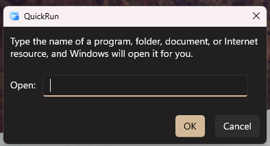

# QuickRun

A modern reimagining of the classic Windows Run dialog.

QuickRun brings the familiar Windows "Run" experience into the Windows 11 era with a clean interface, modern design language, and a lightweight user experience.


## Overview

QuickRun is a lightweight launcher inspired by the classic Windows Run dialog (`Win + R`).

The goal of the project is not to replace advanced launchers such as PowerToys Run, but to provide a modern, native-feeling alternative that respects the simplicity and immediacy of the original Windows experience.

Unlike the traditional Run dialog, QuickRun provides intelligent command suggestions, application discovery, Microsoft Store app support, built-in calculations, URL launching, and a modern WinUI 3 interface.

## Features

### Current Features

- Modern Windows 11 inspired user interface
- Lightweight and fast startup
- Native WinUI 3 implementation
- Execute Windows system commands
- Launch desktop applications and executables
- Launch Microsoft Store applications
- Automatic installed application discovery
- Real-time command suggestions
- Built-in calculator
- Support for command-line arguments
- URL launching support
- Keyboard-focused workflow
- Automatic input focus on startup
- Windows Shell shortcut support
- Custom application icon
- Minimal design with familiar behavior

### System Commands

QuickRun includes support for commonly used Windows tools and utilities.

#### System Tools

```text
notepad
calc
cmd
powershell
wt
explorer
regedit
taskmgr
control
msconfig
```

#### Administrative Tools

```text
services.msc
devmgmt.msc
diskmgmt.msc
compmgmt.msc
eventvwr.msc
gpedit.msc
```

#### Shell Shortcuts

```text
shell:startup
shell:downloads
shell:documents
shell:desktop
```

#### Windows Settings & Control Panel

```text
ms-settings:
appwiz.cpl
ncpa.cpl
sysdm.cpl
```

### Installed Application Discovery

QuickRun automatically scans the Windows Start Menu and installed packages to discover available applications.

Examples:

```text
Steam
Discord
Spotify
Google Chrome
Visual Studio
Windows Terminal
Photos
Microsoft Store
WhatsApp
```

Applications can be launched directly from the search box without additional configuration.

### Calculator

QuickRun can evaluate mathematical expressions directly from the search box.

Examples:

```text
2+2
10*5
100/4
(12+3)*2
```

The result is displayed instantly inside the application.

### Command Arguments

Applications can be launched with command-line arguments.

Examples:

```text
notepad test.txt
cmd /k dir
powershell -NoExit
```

### URL Support

QuickRun can open URLs directly using the system's default browser.

Examples:

```text
https://github.com
https://microsoft.com
https://learn.microsoft.com
```

## Why QuickRun?

The Windows Run dialog has been a core part of Windows for decades and remains one of the fastest ways to launch commands and applications.

QuickRun modernizes this experience while preserving its original philosophy:

- Fast
- Simple
- Familiar
- Lightweight

Unlike feature-heavy launchers, QuickRun aims to deliver the most commonly used functionality with minimal overhead and maximum responsiveness.

## Screenshots

### Main Window



## Building

### Requirements

- Windows 10 or Windows 11
- Visual Studio 2022
- .NET 8 SDK
- Windows App SDK

### Clone

```bash
git clone https://github.com/GiosuOffice/QuickRun.git
cd QuickRun
```

### Build

Open the solution in Visual Studio and build the project.

## Technology Stack

QuickRun is built using:

- C#
- .NET 8
- WinUI 3
- Windows App SDK
- Fluent Design principles

## Roadmap

### Completed

- [x] Modern WinUI 3 interface
- [x] Command execution
- [x] AutoSuggest support
- [x] Built-in calculator
- [x] Command argument support
- [x] Installed application discovery
- [x] Microsoft Store application support
- [x] URL support
- [x] Custom application icon
- [x] Windows Shell shortcuts

### Planned

- [ ] Command history
- [ ] Favorites
- [ ] Smart usage-based ranking
- [ ] Web search integration
- [ ] Global hotkey support
- [ ] Custom themes
- [ ] Plugin architecture
- [ ] Fluent Design enhancements
- [ ] Portable mode

## Version

### Current Version

**0.10.15.1036**

### What's New

#### Version 0.10.15.1036

- Rebranded from **Run11** to **QuickRun**
- Added automatic installed application discovery
- Added Microsoft Store application support
- Added desktop application discovery through Start Menu shortcuts
- Added command argument support
- Added built-in calculator functionality
- Added URL launching support
- Improved AutoSuggest behavior
- Improved command execution engine
- Improved application search experience
- Added support for launching desktop and Store apps from a single search box
- Added custom QuickRun branding and icon
- Various bug fixes and stability improvements

## Project Status

QuickRun is currently under active development.

The project is already fully usable for daily workflows and continues to evolve with new functionality focused on speed, simplicity, and native Windows integration.

## License

This project is currently distributed without a specified license.

Consider adding an open-source license if you plan to accept contributions from the community.

## Acknowledgments

Inspired by:

- The classic Windows Run dialog (`Win + R`)
- Windows 11 Fluent Design
- Modern launcher -

Made with ❤️ using WinUI 3.
